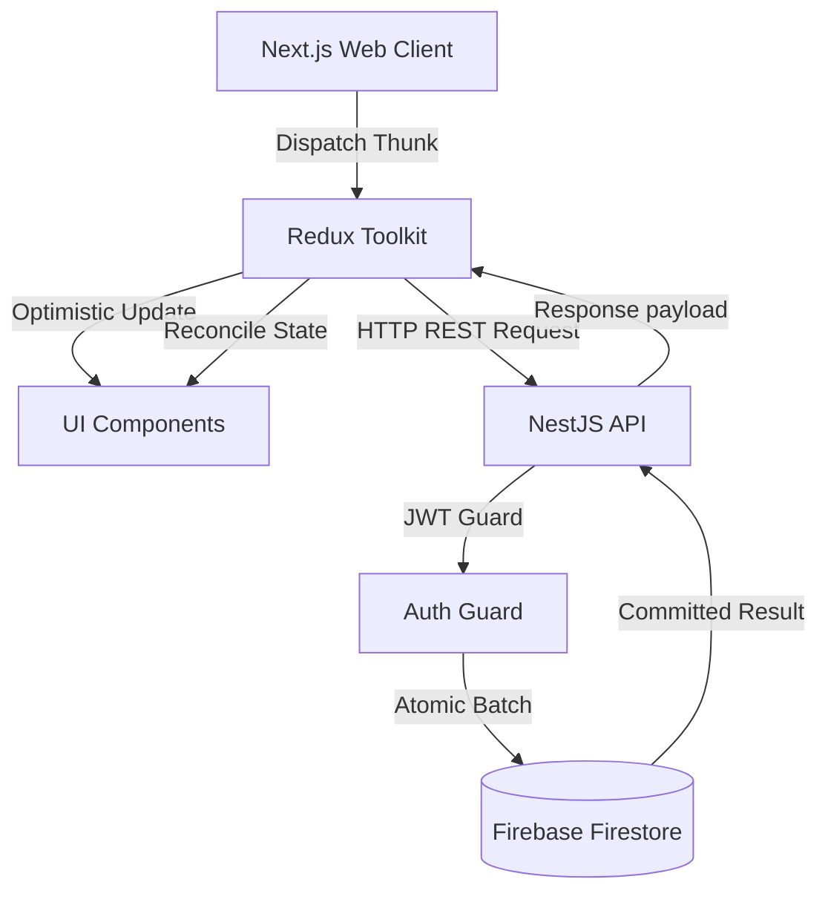

# FinEase Architecture & Systems Overview 🏛️

FinEase is a sovereign wealth architecture platform designed to monitor, model, and govern personal wealth with institutional precision.

---

## 1. Monorepo Organization

FinEase is organized as a high-performance monorepo powered by **Turborepo** and **Yarn Modern (v4)**:

```
finease/
├── apps/
│   ├── web/                     # Next.js 16 Wealth Command Center (Frontend)
│   └── api/                     # NestJS 11 REST API Engine (Backend)
├── packages/
│   ├── types/                   # Cross-boundary domain types and DTOs
│   ├── ui/                      # Shared design system components
│   ├── eslint-config/           # Unified linting rules
│   └── typescript-config/       # Root TypeScript configurations
└── docs/                        # Centralized documentation and specifications
```

---

## 2. Frontend Architecture (`apps/web`)

### Tech Stack

- **Framework**: Next.js 16 (App Router with Turbopack) with React 19.
- **State Management**: Redux Toolkit for unified global state (`accounts`, `transactions`, `goals`, `strategies`, `user`, `categories`, `assetClasses`, `expiries`, `simulations`, `yearlyExpenses`, `ui`).
- **Styling**: Tailwind CSS with custom glassmorphism, dark-mode first palettes, and micro-interactions.
- **Motion**: Framer Motion for spring physics and spatial navigation transitions.
- **Icons**: Lucide React.
- **Data Visualization**: Recharts for Net Worth trajectories, Monthly Growth pulse trends, and asset allocation donuts.

### Core Frontend Subsystems

1. **Wealth Command Center (`/dashboard`)**:
   - **Executive Net Worth Trajectory Hero**: Time-horizon filtering (`1M`, `6M`, `1Y`, `ALL`), decoupled % and delta badges, responsive area visualization.
   - **Monthly Overview (Cash Flow Debrief)**: 3 distinctive metrics (`Period Inflow`, `Period Outflow`, `Net Cash Flow`) with executive insight and dynamic savings/growth rate badges.
   - **Liquid Capital Consolidation**: Positioned directly below Monthly Overview, showcasing liquid bank and cash balances with individual reserve allocation bars.
   - **Real-Time Asset Allocation Donut**: Computed live from account balances with zero lag or stale stats dependencies.
   - **Goal Velocity Navigator**: Real-time progress monitoring towards financial North Stars.
2. **Wealth Pulse & Periodic Check-in Engine**:
   - Atomic batch sync modal for instant balance updates across accounts.
   - Point-in-time snapshot generator recording historical checkpoints.
   - Comprehensive Edit Snapshot Modal with live recalculation and mobile-first horizontal rows.
   - Confirmation modals matching the Delete Account standard for destructive actions.
3. **Analytics & Reports (`/reports`)**:
   - **Monthly Growth & Trajectory Chart**: Baseline net worth tracking from initial pulse checkpoints with delta accumulation.
   - **Historical Trajectory View**: Deep log of all wealth pulses with note inspection and rollback triggers.
   - Inline Account dropdown filter integrated cleanly in the header bar.
4. **Privacy & Ghost Mode**:
   - Global toggle masking all financial balances with `*****` for public usage.
   - Synchronized across charts, cards, inputs, and modals.
5. **Modal Governance**:
   - Centralized modal rendering via `GlobalModals.tsx`.
   - Strict outside-click prevention (modals only close when tapping the explicit close `X` icon or Cancel).

---

## 3. Backend Architecture (`apps/api`)

### Tech Stack

- **Framework**: NestJS 11 (Node.js runtime).
- **Database**: Google Cloud Firestore via Firebase Admin SDK.
- **Authentication**: Firebase JWT verification guard + Passport strategy.
- **API Documentation**: OpenAPI / Swagger (`@nestjs/swagger`) on `/api/docs`.

### Core Backend Modules & Services

- **`AuthModule`**:
  - User session verification, identity handling, and security gates.
  - Active session registry with device parse and remote revocation (`/auth/sessions`).
- **`FinanceModule`**:
  - `AccountsService`: Account lifecycle, atomic batch synchronization (`/finance/accounts/batch-sync`), snapshot rollback/editing (`/finance/snapshots`), and clean cash-flow debrief calculation (`/finance/debrief`).
  - `TransactionsService`: Chronological ledger replay engine (`recalculateBalances`), CSV parsing, category management.
  - `GoalService`: Goal creation, progress tracking, and monthly cadence calculation.
  - `ExpiriesService`: Policy, document, and recurring renewal tracking.
  - `StrategyService`: 50/30/20 and custom protocol budget strategies.
  - `SimulationsService`: Forward-looking scenario sandbox for major life capital events.
  - `YearlyExpensesService`: Annual commitments and unlinked node tracking.
- **`CommonModule`**:
  - `UsersService`: User profile persistence with strict password sanitization on queries (`findOne`, `findAll`).
  - `ActivityLogService`: Comprehensive audit trail of all platform updates.

---

## 4. Data Flow & Synchronization



1. **Optimistic Updates**: Client renders immediate UI updates (<50ms feedback) for seamless interaction.
2. **Atomic Batch Writes**: Multi-account synchronizations and snapshot saves commit atomically in Firestore.
3. **Bidirectional Rollbacks**: Snapshot modifications or deletions automatically update or revert the actual accounts in Firestore and the Redux store.
