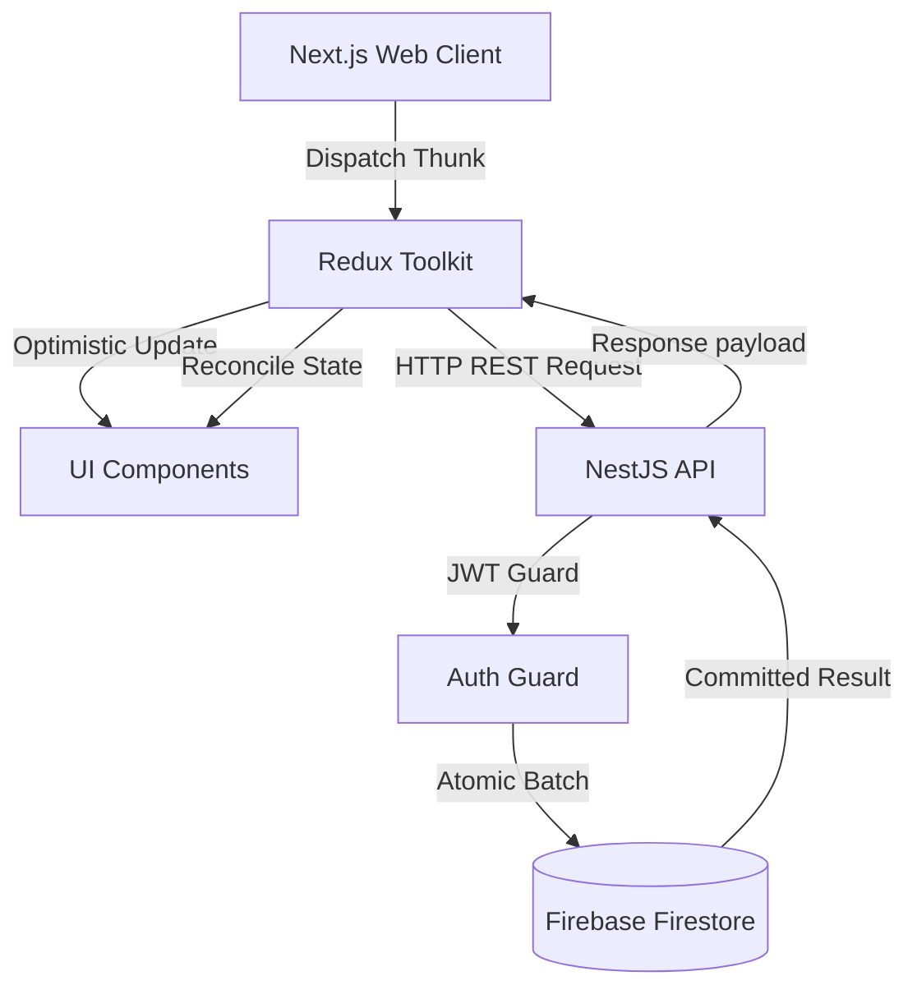

# FinEase Architecture & Systems Overview 🏛️

FinEase is a sovereign wealth architecture platform designed to monitor, model, and govern personal wealth with institutional precision.

---

## 1. Monorepo Organization

FinEase is organized as a high-performance monorepo powered by **Turborepo** and **Yarn Modern (v4)**:

```
finease/
├── apps/
│   ├── web/                     # Next.js 16 Wealth Command Center (Frontend)
│   └── api/                     # NestJS 11 REST API Engine (Backend)
├── packages/
│   ├── types/                   # Cross-boundary domain types and DTOs
│   ├── ui/                      # Shared design system components
│   ├── eslint-config/           # Unified linting rules
│   └── typescript-config/       # Root TypeScript configurations
└── docs/                        # Centralized documentation and specifications
```

---

## 2. Frontend Architecture (`apps/web`)

### Tech Stack

- **Framework**: Next.js 16 (App Router) with React 19.
- **State Management**: Redux Toolkit for unified global state (accounts, transactions, goals, strategies, ui).
- **Styling**: Tailwind CSS with custom glassmorphism, dark-mode first palettes, and micro-interactions.
- **Motion**: Framer Motion for spring physics and spatial navigation transitions.
- **Icons**: Lucide React.
- **Data Visualization**: Recharts for Net Worth trajectories and asset allocation donuts.

### Core Frontend Subsystems

1. **Wealth Command Center (`/dashboard`)**:
   - Executive Net Worth trajectory hero card.
   - Minimalist Monthly Growth Debrief card with top gainer and capital leakage insights.
   - Streamlined Liquid Capital widget displaying liquid cash and bank reserves.
   - Asset & Liability Allocation donut and goal pacing monitors.
2. **Wealth Pulse & Periodic Check-in Engine**:
   - Atomic batch sync modal for instant balance updates across accounts.
   - Point-in-time snapshot generator recording historical checkpoints.
   - Comprehensive Edit Snapshot Modal with live recalculation and mobile-first horizontal rows.
   - Confirmation modals matching the Delete Account standard for destructive actions.
3. **Analytics & Reports (`/reports`)**:
   - Inline Account dropdown filter integrated cleanly in the header bar.
   - Growth Log tab with collapsible cards (showing full date, time, and notes upon expansion on mobile).
   - Cash flow, category breakdown, and export facilities.
4. **Privacy & Ghost Mode**:
   - Global toggle masking all financial balances with `*****` for public usage.
   - Synchronized across charts, cards, inputs, and modals.
5. **Modal Governance**:
   - Strict outside-click prevention (modals only close when tapping the explicit close `X` icon or Cancel).

---

## 3. Backend Architecture (`apps/api`)

### Tech Stack

- **Framework**: NestJS 11 (Node.js runtime).
- **Database**: Google Cloud Firestore via Firebase Admin SDK.
- **Authentication**: Firebase JWT verification guard + Passport strategy.
- **API Documentation**: OpenAPI / Swagger (`@nestjs/swagger`) on `/api/docs`.

### Core Backend Modules

- **`AuthModule`**: User session verification, identity handling, and security gates.
- **`FinanceModule`**:
  - `AccountsService`: Full account lifecycle, batch syncing, and snapshot tracking.
  - `TransactionsService`: Ledger replay engine (`recalculateBalances`), CSV parsing, category management.
- **`GoalsModule`**: Goal creation, tracking, and monthly cadence calculation.
- **`StrategiesModule`**: 50/30/20 and custom protocol budget strategies.
- **`SimulationModule`**: Forward-looking scenario sandbox for major life capital events.
- **`ActivityLogModule`**: Comprehensive audit trail of all platform updates.

---

## 4. Data Flow & Synchronization



1. **Optimistic Updates**: Client renders immediate UI updates (<50ms feedback) for seamless interaction.
2. **Atomic Batch Writes**: Multi-account synchronizations and snapshot saves commit atomically in Firestore.
3. **Bidirectional Rollbacks**: Snapshot modifications or deletions automatically update or revert the actual accounts in Firestore and the Redux store.
